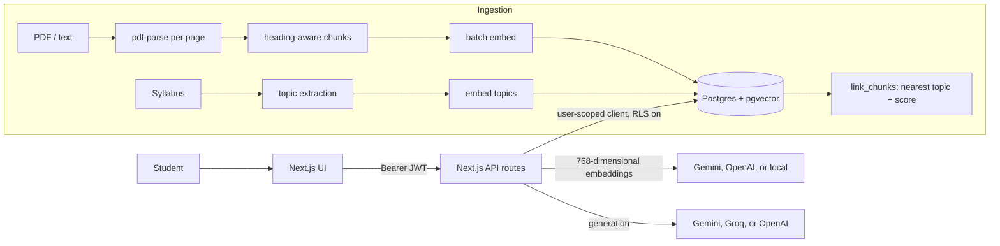

# GapFinder AI

**Diagnosis-first study app.** It finds what a student doesn't know *before* they ask, then builds the revision plan from it.
Most study tools wait for a question. A student can't ask about a gap they don't know they have.

Next.js 15 · TypeScript · Tailwind · Supabase (Postgres + pgvector + Auth) · Vercel AI SDK · Gemini, Groq, OpenRouter, or OpenAI

## Try it
Demo account (after running the seed, see Setup): **demo@gapfinder.ai / GapFinder#2026**.
It has a Biology syllabus, notes and a past paper loaded, plus three simulated quiz attempts so every screen is populated.

## Problem statement
Students revise topics they already know and leave weak ones untouched. Chat-with-your-PDF tools only answer what is asked. GapFinder AI turns the student's own syllabus, notes and past papers into a topic map, tests them with questions grounded in that material, rates every topic weak / medium / strong with a stated reason, and plans revision time around the gaps.

## Feature map
| Requirement | Where |
|---|---|
| Material upload (PDF/text) | `/materials` → `POST /api/ingest` |
| Topic map from syllabus | `lib/ingest.ts` (LLM extracts topics + marks weighting; heading fallback) |
| Diagnostic quiz with citations | `/quiz` → `POST /api/quiz`, `lib/quiz.ts` |
| Answer evaluation + explanation | `POST /api/evaluate` |
| Gap report with reasons | `/` → `GET /api/diagnosis`, `lib/gap.ts` |
| Personalised revision plan | `/plan`, `lib/gap.ts#buildPlan` |
| Explain-this-topic assistant | `/ask` → `POST /api/explain` |
| Progress dashboard | `/progress` (diagnosis recomputed "as of" each quiz) |
| Secure auth + personal documents | Supabase Auth + row-level security on every table |

## Architecture

Every API route builds its Supabase client from the caller's JWT, so row-level security applies. The service key is used only by `npm run seed`.

## RAG pipeline
1. **Parse.** `pdf-parse` renders text page by page (page numbers are kept for citations). Files with no extractable text (scans) are rejected with a clear message.
2. **Chunk.** `lib/chunk.ts` is heading-aware: it tracks a heading stack, so a chunk's heading is its path (`Photosynthesis › Calvin cycle`). Sections are split into ~900-character windows with 120 overlap, preferring paragraph/sentence boundaries. Past papers are chunked one numbered question per chunk.
3. **Embed.** A 768-dimensional Gemini, OpenAI, or local hashing embedding over `heading + content`, in batches.
4. **Store.** `chunks` table with an HNSW cosine index.
5. **Link to topics.** `link_chunks()` assigns each chunk to its nearest topic by cosine similarity and stores the score (`topic_score`), so linking quality is measurable. Below 0.25 a chunk is left unlinked.
6. **Retrieve.** `match_chunks()` returns the top-k study passages (notes and textbooks only) for the signed-in user and subject, optionally restricted to a topic.

## AI workflow: what is retrieval, generation, and code
| Step | Technique | Notes |
|---|---|---|
| Topic map | LLM extraction from the syllabus | Heading-based fallback if the call fails |
| Question generation | **Retrieval, then generation** | The LLM sees only the retrieved passages |
| Citation check | Code | Each question must cite a retrieved chunk id **and** include a verbatim evidence excerpt that is found inside that chunk. Otherwise it is dropped |
| Grading | Code | Compare the selected option with the key. No LLM |
| Explanation | Generation | Written from the cited passage only |
| Gap analysis | Code (`lib/gap.ts`) | Deterministic and unit-tested |
| Revision plan | Code (`lib/gap.ts`) | Deterministic and unit-tested |
| Explain assistant | **Retrieval, then generation** | Refuses if the best match is below `EXPLAIN_MIN_SIM` (0.35) or the model reports `NOT_IN_MATERIAL` |

**How the two stay separate:** retrieval is the only source of facts and returns ids. Generation can only use what retrieval returned, and the server verifies that claim (chunk id + verbatim evidence) before a question reaches the student. Passages are treated as data in every prompt.

## Diagnosis and plan
- `mastery = Σ(correct × difficulty × e^(−age/14d)) / Σ(difficulty × e^(−age/14d))`
- weak < 40%, medium < 75%, strong otherwise; **not rated** until 3 answers
- Each rating carries a reason, e.g. "3/7 correct (43% after weighting harder and more recent questions). Hard questions: 0/2. Last 3: 1/3."
- `priority = (1 − mastery) × syllabus weight × (1 + 0.5 × past-paper frequency)`; unknown mastery counts as 0.5
- Daily minutes are split in proportion to priority; blocks under 10 minutes are dropped. Recomputed on every request, so the plan updates as the student improves.
- Quizzes pick topics by the same priority, so questions go where the gaps are likely to be.

## Setup
1. Create a Supabase project. In the SQL editor run `supabase/schema.sql`.
2. In Supabase → Authentication → Providers → Email, turn off "Confirm email" (so sign-up works instantly for judges).
3. `cp .env.example .env.local` and fill in your Supabase settings plus one AI provider. For a no-cost option, create a [Groq API key](https://console.groq.com), then set `AI_PROVIDER=groq`, `GROQ_API_KEY=...`, `CHAT_MODEL=openai/gpt-oss-20b`, and `EMBEDDING_PROVIDER=local`. Groq powers generation while local hashing embeddings keep retrieval free. Free cloud plans still have provider rate limits.

   Alternatively, set `AI_PROVIDER=openrouter`, `OPENROUTER_API_KEY=...`, `CHAT_MODEL=openrouter/free`, and `EMBEDDING_PROVIDER=local`. OpenRouter routes generation to a free model while the app keeps retrieval local. Do not set both providers as active.
4. `npm install`
5. `npm run seed`: creates the demo user, ingests `samples/`, simulates three quiz attempts (about 20 LLM calls).
6. `npm run dev` → http://localhost:3000
7. Deploy: import the repo in Vercel and add the same env vars (the service key is only needed locally for seeding).

When changing embedding providers, create a new subject or re-upload its materials so that every stored passage and future query uses the same vector format.

## Tests and evaluation
- `npm test`: unit tests for chunking and the diagnosis/plan maths (pure code, no network).
- `npm run eval`: against the seeded demo account, reports
  - **topic-linking accuracy** (gold: `samples/eval.json`),
  - **retrieval hit@1, hit@3, MRR**, plus whether off-topic questions are refused and in-scope ones are answered,
  - **question groundedness**: share of generated questions that survive the citation + evidence check, and the share an independent LLM judge says are supported and unambiguous.
  Results are written to `eval-report.json`. Run it on your deployment and put the numbers here.

## Limitations
- Scanned PDFs need OCR first (rejected with a message). Tables and equations extract poorly.
- Uploads are capped at 4 MB per file (Vercel request limit) and 300,000 characters.
- Topic quality depends on the syllabus structure; re-uploading a syllabus merges topics by name and never deletes old ones.
- Questions are multiple choice only; weights and thresholds are sensible defaults, not calibrated on real student data.
- Past papers set topic frequency but are not used as a source for questions or answers.
- A student can read answer keys from their own browser (RLS scopes keys to their own rows). Fine for self-study, not for proctored exams.
- No rate limiting on the AI routes; add one (e.g. Upstash) before public launch. Supabase's default 1,000-row API limit applies to very large histories.
- English only.

## Future enhancements
Class-level analytics for teachers, parent progress views, multi-language material, spaced-repetition reminders, LMS integration (LTI), OCR ingestion, short-answer questions graded against the cited passage, and calibrating thresholds from real attempt data.
