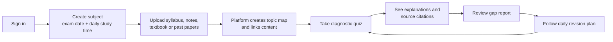
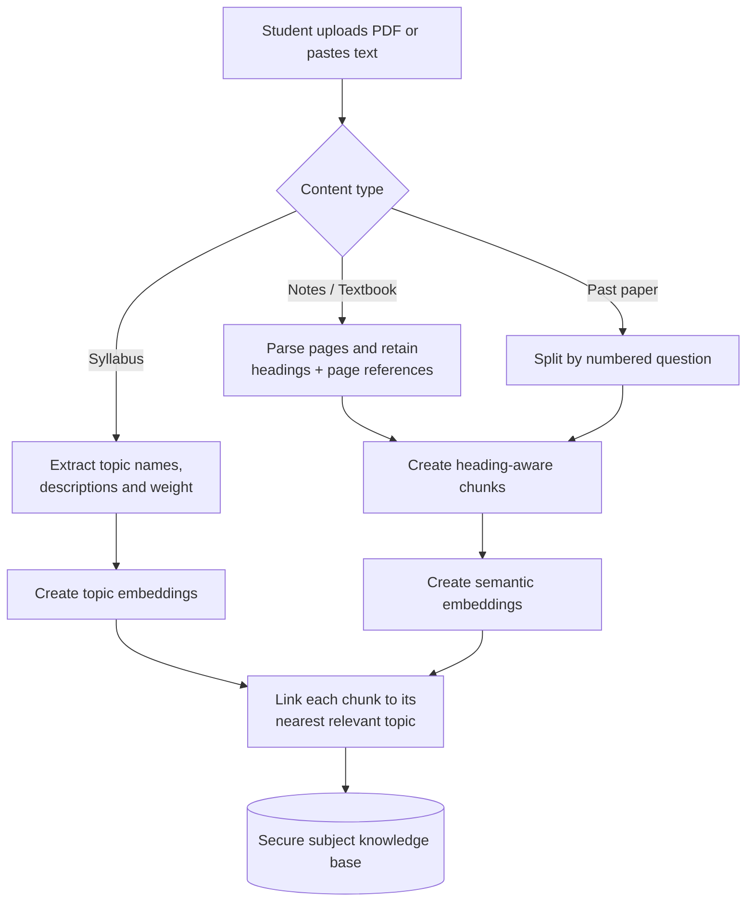
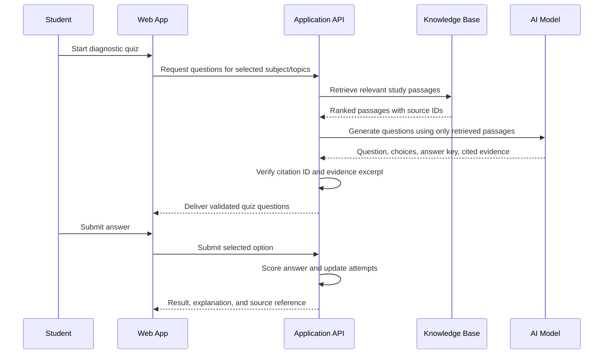
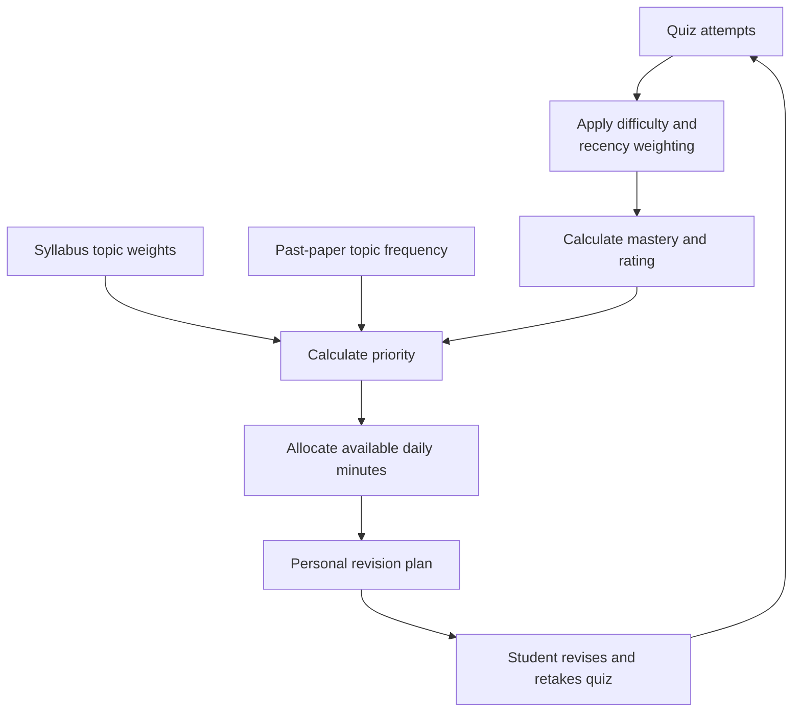
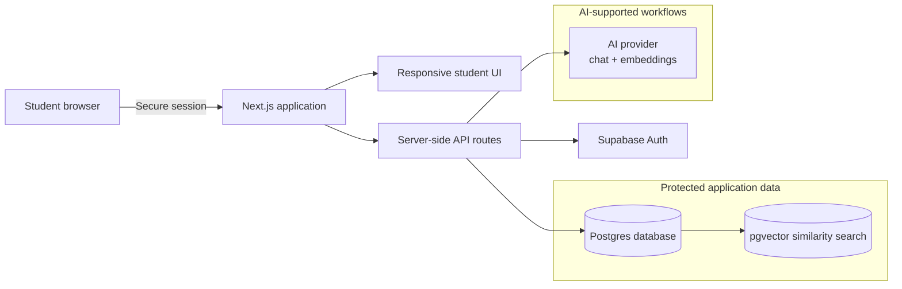
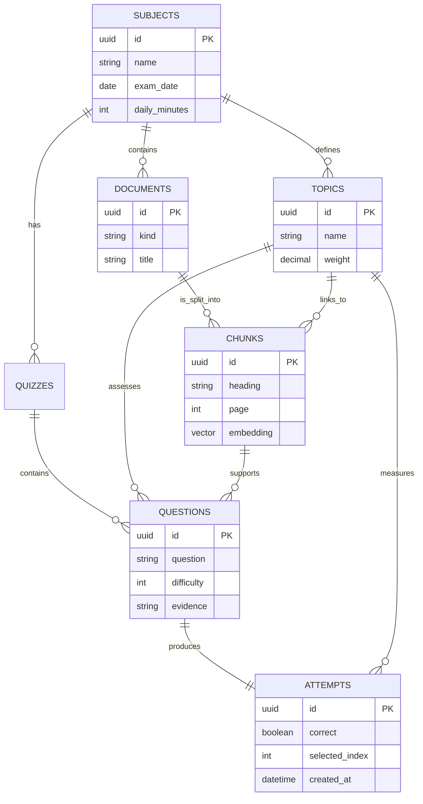
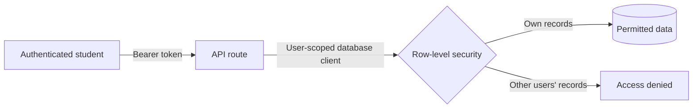
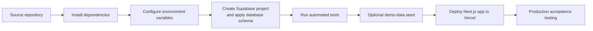

# GapFinder AI

## Client Solution Document

**Prepared for:** Project Client  
**Product:** GapFinder AI — diagnosis-first study platform  
**Document status:** Solution overview and delivery scope  
**Version:** 1.0  
**Date:** 26 October 2026

---

## 1. Executive summary

GapFinder AI is a web application that helps students identify what they do *not* yet understand, before building a revision plan around those gaps. Rather than offering a generic chatbot or a static collection of materials, the platform turns a student's syllabus, notes, textbooks, and past papers into a structured topic map. It then provides source-grounded diagnostic quizzes, explains mistakes with citations, and continuously adjusts a personalised revision plan.

The product is designed for self-directed revision. Its central promise is clear: every recommendation can be traced back to a student's own uploaded material and their assessed performance.

### Client value

| Challenge | GapFinder AI response | Benefit |
|---|---|---|
| Students spend time on familiar topics | Identifies weak, medium, strong, and untested topics | Revision time is directed where it matters most |
| Generic AI answers may be unreliable | Answers and questions are grounded in uploaded passages | More trustworthy, relevant study support |
| Revision plans become outdated | Mastery and priorities are recalculated after quiz activity | The plan evolves with the student |
| Learners cannot see why a topic is weak | Each rating includes an evidence-based reason | Progress is understandable and actionable |

---

## 2. Product scope

### Core capabilities

1. **Secure personal workspace** — students sign in and work only with their own subjects and study content.
2. **Material ingestion** — upload a PDF or paste text and label it as a syllabus, notes, textbook, or past paper.
3. **Topic mapping** — topics are extracted from the syllabus and linked to relevant source content.
4. **Diagnostic quizzes** — multiple-choice questions are created from retrieved study passages, with a citation trail.
5. **Gap diagnosis** — each topic is rated as weak, medium, strong, or not yet rated.
6. **Personal revision plan** — daily study minutes are allocated in proportion to need, syllabus weight, and past-paper relevance.
7. **Grounded study assistant** — students can ask about a topic and receive an answer only when their material supports it.
8. **Progress view** — quiz history shows how assessed mastery changes over time.

### Main user journey

---

## 3. How the platform works

### 3.1 Study-material processing

When a student adds material, GapFinder AI preserves the structure needed to give useful citations. PDFs are parsed page by page; pasted text is treated as a single page. The application detects headings and breaks material into manageable, overlapping passages. These passages are embedded for semantic search and stored against the student's subject.

Past papers contribute to topic priority but are deliberately not used as factual sources for generated answers. This preserves the distinction between assessment signals and learning material.

### 3.2 Source-grounded quiz flow

The application retrieves relevant passages before asking the language model to create a question. A generated question is accepted only if it identifies a retrieved source passage and includes evidence that is found verbatim in that passage. Answers are scored deterministically in code, not by an AI model.

### 3.3 Gap analysis and revision planning

The diagnosis engine is deterministic, auditable, and covered by unit tests. It calculates mastery with greater weight for harder and more recent questions. A topic receives a formal rating after at least three answers.

| Rating | Rule | Recommended action |
|---|---|---|
| Not yet rated | Fewer than 3 answers | Take diagnostic questions |
| Weak | Mastery below 40% | Revisit source material, then practise |
| Medium | Mastery from 40% to below 75% | Practise and resolve specific mistakes |
| Strong | Mastery at or above 75% | Brief weekly recap |

The daily plan prioritises topics with low mastery, higher syllabus weight, and greater representation in past papers. Untested topics are treated as a moderate risk so they are not overlooked.

**Mastery calculation**

`mastery = weighted correct answers / weighted attempted answers`

Each answer weight uses its difficulty and an exponential recency factor. This means a recent difficult answer influences the diagnosis more than an older easy answer.

**Priority calculation**

`priority = (1 − mastery) × syllabus weight × (1 + 0.5 × past-paper frequency)`

---

## 4. Solution architecture

GapFinder AI is implemented as a modern web application with a Next.js user interface and API layer, Supabase for authentication and data, vector search for retrieval, and a configurable AI provider for embeddings and generation.

### Technical components

| Layer | Technology | Responsibility |
|---|---|---|
| Front end | Next.js, React, Tailwind CSS | Student dashboard, material upload, quiz, plan, progress, and Q&A views |
| API layer | Next.js server routes | Authenticated business rules, validation, AI orchestration, and error handling |
| Authentication | Supabase Auth | Secure user sign-in and identity tokens |
| Operational data | Supabase Postgres | Subjects, documents, topics, quizzes, questions, and attempts |
| Semantic retrieval | pgvector | Similarity search across uploaded study passages |
| AI integration | Vercel AI SDK with Gemini, Groq, or OpenAI | Topic extraction, question generation, and explanations; Groq can use local hashing embeddings for no-cost retrieval |
| Hosting target | Vercel + Supabase | Production deployment model |

### Core data model

---

## 5. Trust, privacy, and security

### Data isolation

Every business-data table is protected by database row-level security. API requests create a data client from the signed-in user's token, so the database policy limits records to that user. A student cannot access another student's subjects, documents, questions, or results through the application.

### Guardrails for AI-generated content

| Risk | Built-in control |
|---|---|
| Unsupported quiz question | Question must cite a retrieved chunk and provide a verified evidence excerpt |
| Unsupported chat answer | Assistant refuses when retrieval confidence is low or the source material does not contain the answer |
| Prompt-like text inside uploaded documents | Retrieved passages are treated as data in the AI prompt, not as instructions |
| Inconsistent marking | Multiple-choice scoring is deterministic code-based comparison |
| Cross-user data exposure | Authenticated API routes plus row-level security policies |

### Operational limits in the current release

- Uploads are limited to 4 MB per file and 300,000 characters.
- Scanned PDFs without extractable text require OCR before upload.
- English is the supported language.
- The product is designed for self-study, not proctored assessment.
- Rate limiting should be added before a broad public launch.

---

## 6. Student experience by screen

| Area | Student outcome |
|---|---|
| Home / diagnosis | Sees overall mastery, topic ratings, reasons for each rating, and suggested sources to revisit |
| Materials | Adds a syllabus, notes, textbook extracts, or past papers to a subject |
| Quiz | Takes generated diagnostic questions with clear feedback and supporting citations |
| Plan | Receives an actionable daily revision schedule based on available study time |
| Ask | Queries their own materials; the assistant cites sources or explicitly declines to guess |
| Progress | Reviews quiz-level changes in accuracy and topic mastery |

---

## 7. Delivery, deployment, and acceptance

### Deployment flow

### Required environment configuration

| Configuration | Purpose |
|---|---|
| Supabase URL and anonymous key | Browser and authenticated application access |
| Supabase service key | Local demo-data seeding only; not required for normal runtime |
| Gemini, Groq, or OpenAI API key | AI generation; Gemini/OpenAI also provide hosted embeddings |
| `EMBEDDING_PROVIDER=local` (optional) | Free deterministic 768-dimensional embeddings, recommended with Groq |
| Optional model settings | Select supported chat model and explanation retrieval threshold |

### Acceptance criteria

The delivered solution can be accepted when the client can:

1. Register or sign in and create a subject.
2. Upload or paste supported study material.
3. See syllabus-derived topics and material linked to them.
4. Take a quiz with questions that show citations to uploaded material.
5. Submit answers and receive a result and explanation.
6. View topic ratings, stated reasons, and a time-boxed revision plan.
7. Ask an in-scope study question and receive a cited answer; receive a clear refusal for unsupported questions.
8. Confirm that one user cannot view another user's data.
9. Run the automated test suite successfully.

---

## 8. Recommended next-phase roadmap

The current product provides a strong individual-study foundation. The following additions are recommended for a future phase, ordered by practical impact:

1. **Production safeguards:** API rate limiting, usage monitoring, error monitoring, and backup/retention policy.
2. **OCR workflow:** support scanned worksheets and image-only PDFs.
3. **Richer assessment:** short-answer questions and rubric-based feedback grounded in the same cited sources.
4. **Learning reinforcement:** spaced-repetition reminders and scheduled re-testing of weak topics.
5. **Educator features:** class dashboards, teacher-curated material, and intervention insights.
6. **Accessibility and localisation:** multi-language support and expanded accessibility validation.
7. **Integrations:** learning-management-system integration and parent progress sharing where appropriate.

---

## 9. Conclusion

GapFinder AI provides a practical, explainable way to personalise revision. Its defining strength is not simply the use of AI; it is the disciplined combination of student-owned materials, verified source grounding, deterministic performance analysis, and a plan that updates as the learner demonstrates progress.

This makes the solution suitable for a professional education product: useful to students, transparent to stakeholders, and designed with a clear path from prototype to production hardening.
